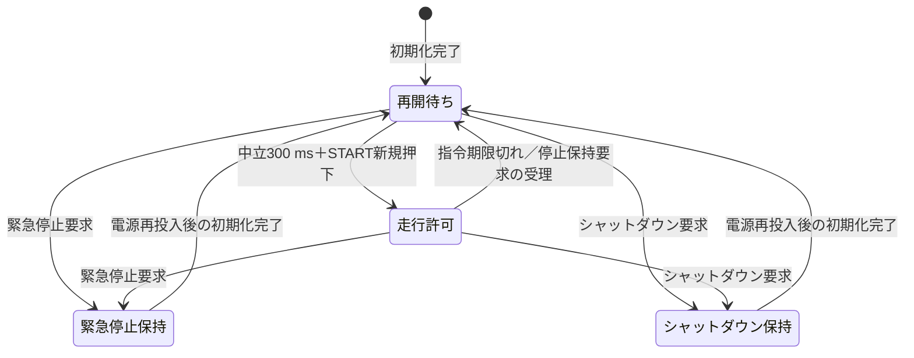

# 安全制御の改善仕様

状態: Q2〜Q15は設計合意済み。2026-10-20。未実装・実機未検証。

[調査とコード根拠](spec_review_2026-10-20.md) | [設計判断](adr/0001-motor-command-expiry.md) | [用語集](../GLOSSARY.md)

## 目的と対象

通信異常・PS3再接続・センサー復旧中も、意図しない駆動継続や再始動を防ぐ。対象はSTM32、関連ESP32、Webの状態表示。本文の時間は駆動出力に関する設計値であり、実回転速度や車体停止時間ではない。

## 合意済みの要件

| ID | 要件 | 合意 |
|---|---|---|
| SAFE-01 | 左右指令を1つのSPIコマンドで検証し、同時に採用する。片方が不正なら両方不採用とし、指令期限を更新しない | Q2・Q9 |
| SAFE-02 | 最後の有効なモーター指令から250 msで期限切れ。両輪の駆動出力を260 ms以内にゼロにする。センサー要求・ライト操作・不正パケットで期限を延長しない | Q2・Q8 |
| SAFE-03 | STM32の制御更新は5 ms周期、最大更新間隔10 ms。センサー故障・復旧中も同じ条件を検証する | Q8 |
| SAFE-04 | 通常のPWM指令変化は0→1000、1000→0を各500 msとする。途中の指令値にも同じ変化率を適用する。異常時停止は通常減速を待たない | Q4 |
| SAFE-05 | 逆方向への駆動はPWM出力ゼロから100 ms以上待つ。通常停止を挟んでも反転待ちを迂回しない | Q5 |
| SAFE-06 | 起動・PS3再接続・通信復旧後は再開待ち。操作2軸の中立を300 ms連続で確認し、その後のSTART新規押下で走行を許可する。接続前の入力と中立確認時間を持ち越さない | Q3・Q6 |
| SAFE-07 | □の新規押下で緊急停止。緊急停止・シャットダウンは電源再投入まで保持し、STARTで解除しない | Q7 |
| SAFE-08 | 走行指令のACK欠落・NACK・不正応答を1回検出したら、ESP32も停止要求を送り、再開待ちへ移る。停止要求が届かない場合もSTM32の指令期限を適用する | Q11 |
| SAFE-09 | ESP32とSTM32は対応する新ファームを両方更新する。旧ファームとの混在で走行を許可せず、旧形式の速度指令で走行する互換経路を残さない。停止・緊急停止は引き続き受理する | Q10 |
| SAFE-10 | WebにSTM32が報告した走行許可状態・停止理由を表示する。状態を取得できなければ「通信不明」とし、過去の状態を現在の確定状態として扱わない | Q12 |
| SAFE-11 | センサーはVersion 2・32 byteを維持し、完成したスナップショットだけを公開する。加速度/ジャイロ・地磁気の有効期限は各250 ms、温度/気圧は1000 ms。群別取得時刻の追加は今回の対象外 | Q13 |
| SAFE-12 | PS3切断を検出したら、通常減速を待たず駆動出力ゼロ・再開待ちへの移行を要求し、ヘッドライトの消灯も要求する。再接続後はSAFE-06で再開可能とする | Q14 |
| SAFE-13 | Hブリッジの型番・真理値表の確認と、制動特性・停止距離の実機試験を、実機走行の前提条件として残す | Q15 |

中立の判定は既存の `abs(ly)<20 && abs(rx)<20` を使う。最大指令1000はPWMデューティの指令値であり、速度の実測値ではない。

## 状態遷移

- 通常停止はPWMを減速させる操作であり、通信異常などで走行許可を失う処理と区別する。
- ESP32が再開待ちでも、STM32が停止要求を未受信なら停止完了とは扱わない。
- 走行許可を失った後は、新たな再開操作まで速度指令で駆動を再開しない。
- 電源再投入以外のリセットによって緊急停止・シャットダウンを解除しない。保持方法とリセット時の出力確認は実装時に検証する。
- PS3切断は再開待ちへ移す要求とする。緊急停止保持にはせず、再接続後は中立確認と再開操作で走行を許可できる。

## 実装で解消する現行の問題

- Hブリッジの初期化完了前に操作コマンドを実行しない。
- センサー再初期化の待ち時間に、モーター更新・SPIフレーム境界処理が止まらない構成にする。
- センサーの値・状態・時刻・シーケンスを一貫した公開単位として読み出せるようにする。
- 走行指令の応答は元CMDが一致するACKだけを成功とし、任意の有効パケットを成功扱いにしない。
- 新しい走行許可・状態照会・左右同時指令の具体的なコマンドIDと配置は、実装設計で既存IDと整合させる。

## 受入条件

| 試験 | 確認内容 |
|---|---|
| 指令途絶 | 最後の有効指令から260 ms以内に両輪の駆動出力がゼロになる |
| 無関係な通信 | センサー要求・ライト操作・不正パケットだけでは指令期限が延びない |
| センサー故障と復旧 | 更新間隔10 ms以下を満たし、停止指令と後続SPIフレームを受理する |
| 通常停止と反転 | 500 msの通常ランプと、出力ゼロから100 ms以上の反転待ちを確認する。途中停止・再指令でも迂回しない |
| 起動と再接続 | スティックを倒したままの接続やSTART長押しで走行を許可しない |
| PS3切断 | 両輪の出力ゼロ・再開待ち・消灯が要求され、停止要求が届かない場合も指令期限で停止する |
| 緊急停止 | □で通常減速を待たず停止し、START・通信復旧・電源再投入以外のリセットで走行許可に戻らない |
| 応答異常 | ACK欠落・NACK・別CMDのACK・別種パケットで、ESP32が再開待ちへ移る |
| 左右同時性 | 片方が不正な指令で両方不採用となり、片輪だけの更新が起きない |
| ファーム混在 | 新ESP32＋旧STM32、旧ESP32＋新STM32の両方で走行しない |
| 状態表示 | 停止理由が表示され、状態未取得時に「通信不明」へ変わる |
| センサー応答 | 32 byte・Version 2を維持し、新旧データの混在が起きない |
| 回路と実機 | 型番・真理値表・停止時の出力状態を確認し、制動特性・停止距離を記録する |

## 実装時に具体化する事項

- 新コマンドのID、配置、対応バージョンの照会方法。
- 緊急停止保持を電源再投入とその他のリセットで区別する方法。
- センサー復旧を待ち状態に分割し、制御更新とSPI受信を継続する構成。
- Web状態の更新期限と、実測結果の記録方法。

今回の調査と仕様合意は完了。追加の判断が生じた場合は推奨案と理由を記録して進め、ユーザーが後で確認する。

## 未確認の事実

- Hブリッジの型番・回路図・メーカー真理値表は未入手。両入力LOW、駆動許可LOWの物理的な制動特性は未確認。
- 反転100 msとランプ500 msは実機検証前の値。機体・負荷に対する妥当性は実測で判断する。
- 停止距離、最大更新間隔、起動中やリセット中の出力波形は未測定。

既存の要件定義書・設計書は現行実装の記録として残している。実装後に本仕様との対応と検証結果を確認し、現行文書を更新する。
